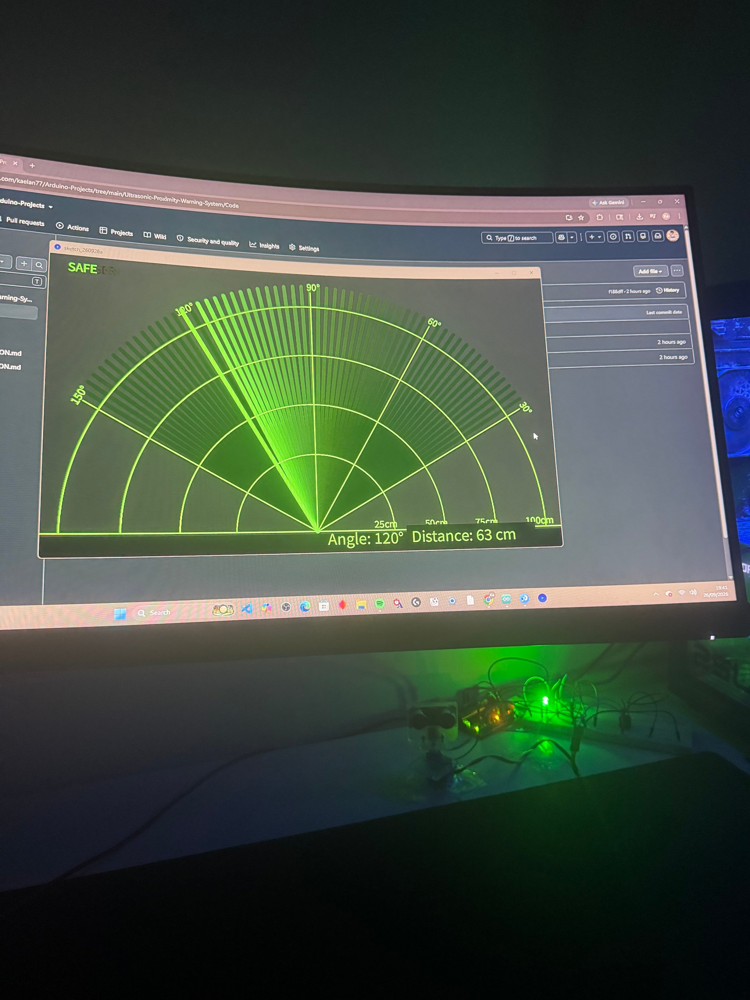
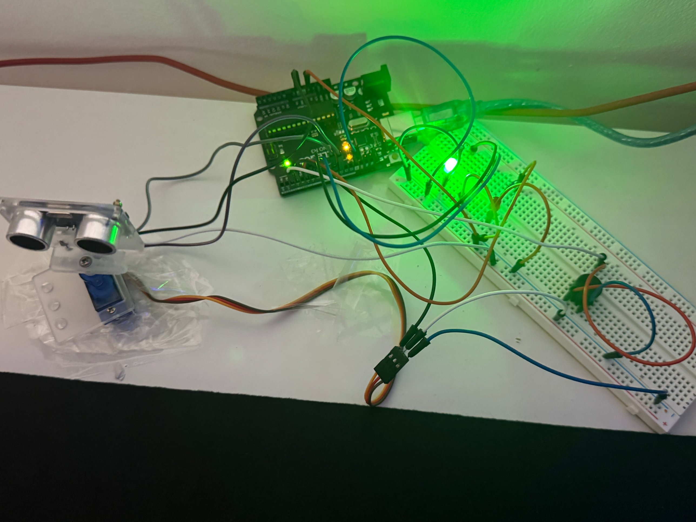
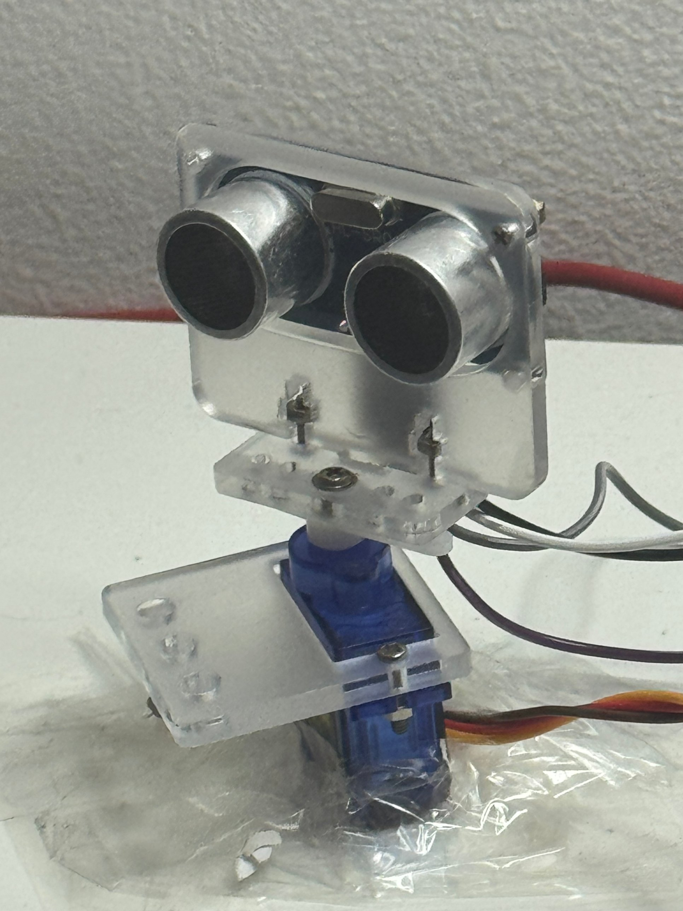
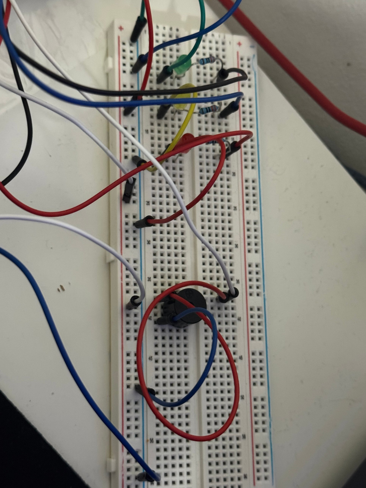
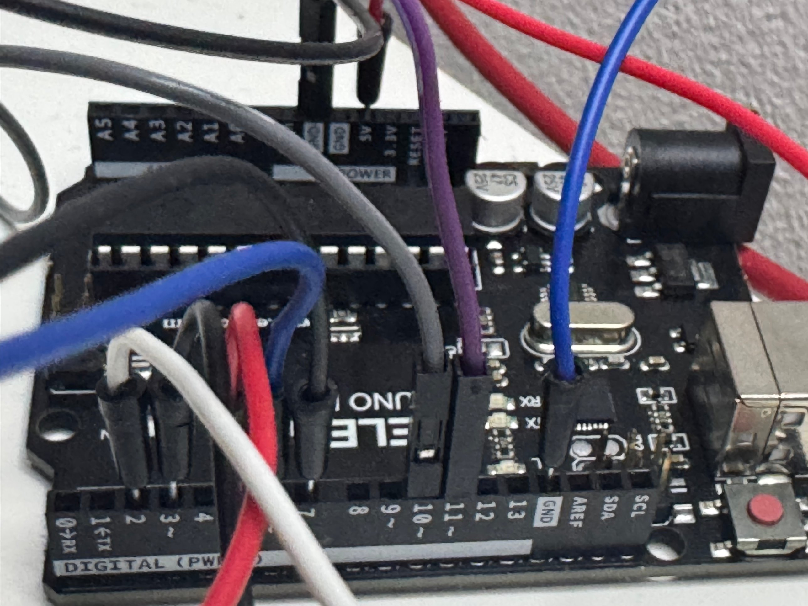

# Phase 2 – Radar Scanning System with servo and buzzer

## Overview

After completing the basic proximity warning system in Phase 1, I wanted to make the project more interactive and realistic. Instead of only detecting objects directly in front of the sensor, I added a servo motor so the ultrasonic sensor could scan across an area and detect objects at different angles.

I also connected the project to a radar-style interface on my computer using Processing. This allowed me to visualise the sensor readings in real time and see where objects were being detected.

---

## What I Added

### Servo Motor

The biggest addition in this phase was a servo motor mounted underneath the HC-SR04 sensor.

The servo continuously rotates the sensor from side to side, allowing it to scan a wider area rather than only measuring distance straight ahead.

### Radar Visualisation

I integrated a radar-style interface using Processing to display the sensor data live on my computer.

The radar receives angle and distance data from the Arduino through serial communication and plots detected objects on screen.

### Improved Warning System

The LED and buzzer warning system from Phase 1 was carried over and works alongside the radar system.

- Green LED = Safe (>20 cm)
- Yellow LED = Caution (10–20 cm)
- Red LED = Danger (<10 cm)

---

## Challenges I Faced

### False Detections

One issue I ran into was the sensor constantly detecting objects that I wasn't actually trying to scan. At first I thought there was something wrong with the code, but after testing I realised the ultrasonic sensor was picking up parts of my monitor, cables, and other objects around my desk. To fix this, I adjusted the position of my monitor and changed the scanning range of the servo so it wouldn't point towards areas that were causing unwanted detections. This made the readings much more reliable.

### Choosing the Scan Range

Originally I wanted the servo to scan as far as possible, but a wider sweep created more false readings and unnecessary detections. After some testing, I reduced the scan range and found a balance between coverage and accuracy. This taught me that bigger isn't always better ,sometimes calibration is more important than maximising specifications.

### Radar Communication Issues

When I first connected the Arduino to the radar software, nothing appeared on screen. After troubleshooting, I discovered that the serial data format being sent by the Arduino didn't match what the Processing program expected. Once I corrected the serial output and baud rate settings, the radar started displaying live readings correctly.

---

## What I Learned

This phase taught me a lot about integrating multiple systems together. Up until this point, most of my projects involved getting hardware working correctly. In this project I had to make hardware, software, serial communication, and visualisation all work together. I also learned how important testing and calibration are in engineering. The project technically worked from the beginning, but it took several rounds of adjustments to get consistent and reliable results.

Working with the servo also introduced me to concepts such as scan resolution, sweep angles, and balancing performance against accuracy.

---

## My Contributions

- Mounted the sensor on the servo and wired the buzzer.
- Programmed the scanning sweep and the buzzer warnings.
- Set up serial communication between the Arduino and Processing.
- Tested and calibrated the system, and fixed the false detections.

Note: the radar display is adapted from an existing Processing framework. I modified it to read my Arduino's data. The hardware, Arduino code, serial communication and calibration are my own work.

---

## Photos

The radar-style display running live alongside the hardware. Here it reads 120° and 63 cm.

The full system running: the sensor on the servo, the Arduino Uno and the breadboard, with the green "safe" LED lit.

The HC-SR04 sensor mounted on the servo, which sweeps it from 30° to 150°.

The breadboard circuit: green, yellow and red LEDs with 330 Ω resistors, plus the buzzer.

The Arduino Uno pin connections.

---

## Note on the Radar Interface

The original radar visualisation framework was not developed by me.I used it as a starting point and modified it so it could communicate with my Arduino project and display live sensor readings.

My work focused on the hardware integration, serial communication, system calibration, and adapting the interface for this project.

---

## What I'd do differently

- Check the surroundings for reflective objects before setting the sweep range, instead of fixing false detections afterwards.
- Agree the serial data format between the Arduino and the display before writing either side.
- Test a narrow sweep first and widen it gradually, rather than starting as wide as possible.

